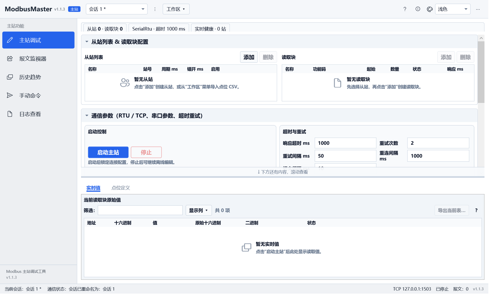
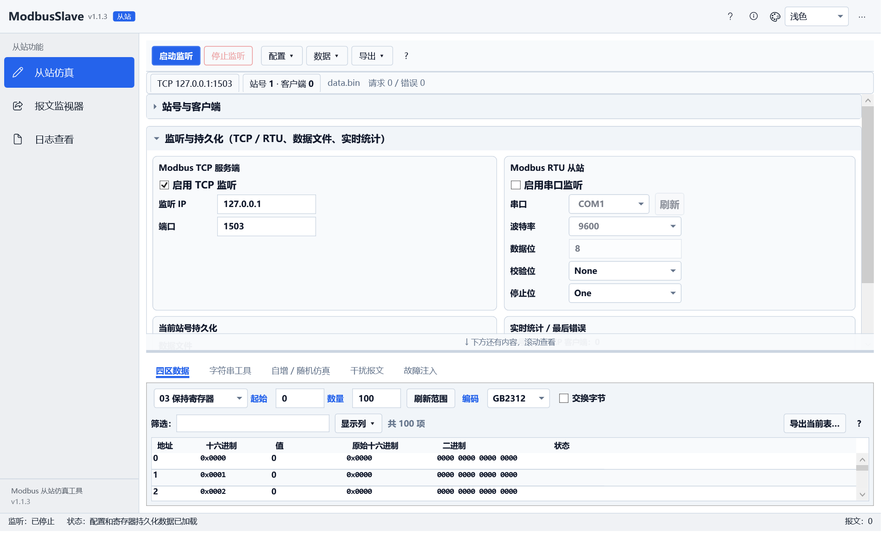

# ModbusTool

ModbusTool 是面向工业现场的 Modbus 主站 / 从站双独立调试套件，可替代 Modbus Poll / Modbus Slave，用于 PLC、变频器、仪表、智能模块的协议调试、仿真、压力测试与异常报文验证。

- **ModbusMaster**（`src/ModbusMasterApp`）：多 Tab 独立会话并行调试，支持线圈、离散输入、保持寄存器、输入寄存器点位配置，CSV 点位表导入导出，双击写入，ScottPlot 实时趋势曲线，报文染色监视与分级日志导出。
- **ModbusSlave**（`src/ModbusSlaveApp`）：Modbus TCP / RTU 从站仿真，支持四区寄存器、固定值 / 自增 / 随机仿真、故障注入（丢包、CRC 错误、异常响应、延时报文）与数据持久化。

协议帧编解码、RTU/TCP 传输、CRC16 校验、主站调度与从站服务均为自研实现，不依赖 NModbus 等第三方协议栈。源码、原创主从站图标与文档采用 [MIT License](LICENSE)。

**开发者：工控菜鸡刘**

## 功能清单

- 主站多会话：每个会话独立连接、轮询、写入锁、趋势与响应队列，互不串扰。
- 四区点位：线圈、离散输入、保持寄存器、输入寄存器；支持地址范围、数据类型、字节序与显示格式。
- 写入时序：双击写入立即预览“写入中”，应答后回填真实值，超时或异常显示“写入失败”。
- 实时趋势：ScottPlot 曲线、图例显隐、颜色 / 线宽 / 线型持久化、暂停、缩放、PNG 快照与 CSV 导出。
- 报文监视：发送 / 接收 / 异常 / CRC 错误分类染色，支持原始报文核对。
- 分级日志：Trace / Debug / Information / Warning / Error，结构化通信字段、滚动文件、多维筛选与 CSV 导出。
- 从站仿真：站号管理、四区数据、固定 / 自增 / 随机仿真、故障注入、寄存器文件持久化与旧版数据迁移。
- 主题与布局：浅色、深色、工业蓝、深灰工业四套主题，主从站独立图标与帮助 / 关于窗口。

## 功能截图

仓库内截图位于 `docs/archive/screenshots/`，不随发布包分发：






## 系统要求

| 产物 | 目标系统 | 运行时要求 |
|---|---|---|
| Portable-net8-fd（框架依赖）/ Setup-net8 | Windows 10 1809+、Windows 11，x64 | 需安装 [.NET 8 Desktop Runtime](https://dotnet.microsoft.com/download/dotnet/8.0) |
| Portable-net8-sc（自包含） | Windows 10 1809+、Windows 11，x64 | 无需预装 .NET |
| Portable-net6-fd（框架依赖）/ Setup-net6 | Windows 7 SP1、Windows 8.1、Windows 10、Windows 11，x64 | 需安装 [.NET 6 Desktop Runtime](https://dotnet.microsoft.com/download/dotnet/6.0) |
| Portable-net6-sc（自包含） | Windows 7 SP1 及以上，x64 | 无需预装 .NET |

Windows 7 需要预先安装 SP1 与系统补丁 KB2533623；串口功能受系统自带驱动与硬件限制，详见 [兼容性说明](docs/dev/compatibility.md)。

## 下载与运行

**下载地址：[GitHub Releases](https://github.com/dabaogg699/ModbusTool/releases)**（含安装版、免安装版与源码包，进入对应版本下载附件）。

发布产物按 **Setup（安装版）** 与 **Portable（免安装版）** 分类，文件名格式为：

```text
Setup/ModbusTool-v<版本>-Setup-net8.exe          # 安装版，Win10 1809+ / Win11，需 .NET 8 Runtime
Setup/ModbusTool-v<版本>-Setup-net6.exe          # 安装版，Win7 SP1 ~ Win10，需 .NET 6 Runtime
Portable/ModbusTool-v<版本>-Portable-net8-fd.7z  # 免安装框架依赖（fd），体积小，需 .NET 8 Runtime
Portable/ModbusTool-v<版本>-Portable-net8-sc.7z  # 免安装自包含（sc），自带运行时，离线即用
Portable/ModbusTool-v<版本>-Portable-net6-fd.7z  # 同上，net6 版本对应 Win7 SP1+
Portable/ModbusTool-v<版本>-Portable-net6-sc.7z
ModbusTool-v<版本>-Source.zip                    # 源码包
SHA256SUMS.txt                                   # 全部交付物 SHA256
RELEASE-COPY.txt                                 # Release 页展示文案，可直接复制
```

> 同名 `.zip` 与 `.7z` 并存，`.7z` 为固实压缩，体积更小，推荐分发。

选择建议：

- **普通用户**：优先使用安装包，自动创建开始菜单、卸载入口并检测运行时。
- **已有 .NET 运行时**：使用框架依赖 ZIP，体积最小。
- **离线或无法安装运行时**：使用自包含 ZIP，解压即用。
- **Windows 7**：只能使用 net6 系列产物（Setup-net6 或 Portable-net6-*）。

## 用户数据存放位置

程序安装目录全程只读（兼容 Program Files 的 UAC 限制），用户数据统一存放在：

```text
%APPDATA%\ModbusTool\
├── templates\        # 用户模板（保存的模板）
├── workspaces\       # .mbwork 工作区与 last.mbwork（上次工作状态）
├── runtime-cache\    # slave-config.json、data.bin 等运行缓存
└── logs\             # 运行日志与报文落盘
```

程序内置出厂默认模板（嵌入 exe 资源，只读）：首次启动自动加载（1 个 TCP 会话、站号 1、保持寄存器 0–99）；退出时自动把当前工程保存为 `last.mbwork`，下次启动恢复；工作区菜单提供【重置为初始模板】。卸载程序不会删除 `%APPDATA%\ModbusTool`，如需清理请手动删除该目录。v1.1.7 及更早版本写在安装目录下的模板/配置不会自动迁移，可手动复制到上述对应目录。

安装包默认安装到 `C:\Program Files\ModbusTool`，可在向导中修改；控制面板可正常卸载。

## 快速上手

1. 启动 **ModbusSlave**，保留站号 `1`，选择 TCP 监听，地址 `0.0.0.0`、端口 `502`，启动监听。若端口被占用，可在两端同时改用其他端口。
2. 启动 **ModbusMaster**，新建会话，选择 TCP，主机 `127.0.0.1`、端口 `502`。
3. 添加站号 `1` 的设备和“读保持寄存器”读取块，例如起始地址 `0`、数量 `10`，启动轮询。
4. 在从站编辑保持寄存器，观察主站表格、报文监视器和趋势曲线；也可启动从站自增 / 随机仿真。
5. 在主站保持寄存器表格双击写入。输入值先显示为“写入中”，收到应答后同步真实值；失败或超时显示“写入失败”。
6. 打开日志页，可按会话、功能码、错误类型筛选通信链路，并导出选中或全部缓存日志为 CSV。

完整操作说明见 [用户手册](docs/user/manual.md)。通信相关变更合并前，应在上述配置下连续运行至少 10 分钟，确认错误、超时、内存和句柄无异常增长。

## 从源码构建

要求：

- Windows x64。
- .NET 8 SDK（同时用于编译 net8 与 net6 目标）。
- 运行 net6 测试或程序时，需要 .NET 6 Desktop Runtime（本机双目标测试需要）。

```powershell
dotnet restore ModbusTool.sln
dotnet build ModbusTool.sln -c Release
dotnet test ModbusTool.sln -c Release --no-build
```

启动项目为 `src/ModbusMasterApp/ModbusMasterApp.csproj` 与 `src/ModbusSlaveApp/ModbusSlaveApp.csproj`。完整参数、双模式发布与安装包构建见 [构建与发布](docs/dev/build.md)。

## 发布

```powershell
# 双目标、双模式分发包 + 源码包 + SHA256
powershell -ExecutionPolicy Bypass -File scripts\publish.ps1

# 额外生成 Inno Setup 安装包（需先安装 Inno Setup 6）
powershell -ExecutionPolicy Bypass -File scripts\publish.ps1 -Installer

# 版本已发布、之后才安装 Inno Setup 时，单独补产安装包
powershell -ExecutionPolicy Bypass -File scripts\publish.ps1 -InstallerOnly

# 只生成框架依赖包
powershell -ExecutionPolicy Bypass -File scripts\publish.ps1 -Mode FrameworkDependent
```

脚本会校验 SemVer、版本递增、构建属性、CHANGELOG 与 csproj 版本规则，通过后发布、打包、计算 SHA256，并登记 `version.json.released`。发布包只携带 `docs/help` 与用户手册，不包含开发文档与历史归档。

## 本机环回教程

无需真实 PLC 即可完成 TCP 主从对测：

1. 从站选择 TCP 监听 `0.0.0.0:502`，站号 `1`。
2. 主站新建会话连接 `127.0.0.1:502`，添加站号 `1` 的保持寄存器块。
3. 启动轮询，观察表格、报文与趋势。
4. 双击写入并核对“写入中 → 真实值”的时序。
5. 检查日志筛选与 CSV 导出。

环回不能替代真实 485 线路、串口参数和现场网络联调。

## 目录结构

```text
ModbusTool/
├─ src/
│  ├─ ModbusCore/          # 协议、CRC、字节序、传输、数据模型、日志
│  ├─ ModbusMaster/        # 主站调度、工作区、写入锁与趋势服务
│  ├─ ModbusSlave/         # 从站服务、站管理与仿真
│  ├─ ModbusTool.App/      # 共享 WPF UI
│  ├─ ModbusMasterApp/     # ModbusMaster 启动项目
│  ├─ ModbusSlaveApp/      # ModbusSlave 启动项目
│  ├─ ModbusTool.Update/   # 更新检查逻辑
│  └─ ModbusTool.Updater/  # 独立更新器
├─ tests/                  # Core / Master / Slave / Update 双目标单元测试
│  └─ fixtures/legacy/     # 旧版 MBScan/MBSlave 配置与数据迁移夹具
├─ build/compat/           # net6 编译器特性与 API 兼容补齐
├─ installer/              # Inno Setup 6 安装包脚本
├─ scripts/                # 版本校验、递增、同步与发布脚本
├─ docs/
│  ├─ assets/icon/         # 原创主从站 SVG 图标源文件
│  ├─ help/                # 在线帮助与调试辅助文档
│  ├─ dev/                 # 架构、构建、兼容性文档
│  ├─ user/manual.md       # 用户手册
│  └─ archive/             # 历史截图、规划归档与验收证据
├─ publish/                # 发布产物（构建输出，不入库）
├─ .github/RELEASE_TEMPLATE.md
├─ .gitignore
├─ CHANGELOG.md
├─ CONTRIBUTING.md
├─ LICENSE
├─ version.json            # 唯一版本源
└─ ModbusTool.sln
```

## 日志策略与排查

- 级别：Trace / Debug / Information / Warning / Error；Debug 默认关闭，可在日志面板开启。
- 通信上下文字段：会话 ID、站号、功能码、寄存器地址、原始报文摘要、耗时；错误日志包含异常堆栈。
- 默认单文件上限 5 MB，默认保留 5 个文件（含当前文件），可在日志面板调整。
- UI 最多缓存 5000 条，按 300 条滚动加载；文件队列和历史缓存均有界。
- 支持级别、分类、会话、功能码、错误类型和关键字筛选，支持选中 / 全部 CSV 导出。

高频通信会产生一定磁盘 IO。排查结束后可降低保留数量或关闭不需要的调试日志；不要在现场保留敏感业务报文。

## 版本管理

版本遵循 SemVer，`version.json` 是唯一版本源，禁止在 csproj 中硬编码 `<Version>`。`Directory.Build.props` 只能由脚本同步。

```powershell
powershell -ExecutionPolicy Bypass -File scripts\version.ps1 -Command show
powershell -ExecutionPolicy Bypass -File scripts\version.ps1 -Command validate
powershell -ExecutionPolicy Bypass -File scripts\version.ps1 -Command bump -Part patch -Summary "修复说明"
```

`version.json` 为唯一版本来源；发布脚本在全部产物成功后自动登记 `released`。

## 参与贡献

- 贡献规范、分支与提交约定见 [CONTRIBUTING.md](CONTRIBUTING.md)。
- 问题反馈请附版本、系统、TCP/RTU 配置、站号、功能码、复现步骤与脱敏日志。
- 如果这个项目对你有帮助，欢迎 Star；使用问题优先提交 Issues，便于其他用户检索。

## 已知限制

- WPF 界面与 `System.IO.Ports.SerialPort` 串口实现仅支持 Windows；跨平台不在本版本范围内。
- 发布目标为 Windows x64；其他架构需要重新验证与发布。
- net8 版本不支持 Windows 7；Windows 7 请使用 net6 版本。
- 本机环回不覆盖真实串口电气特性、485 干扰、设备私有协议或现场防火墙。
- 旧版 CSV/配置迁移以兼容已有样例为边界，非标准私有格式需先脱敏并提供样例。
- 系统字体使用 Windows 已有字体，源码和发布包不分发商业字体或第三方图标素材。

## 开源信息

- 许可证：[MIT](LICENSE)，Copyright (c) 2026 工控菜鸡刘
- 作者：工控菜鸡刘
- 仓库地址：https://github.com/dabaogg699/ModbusTool
- 贡献指南：[CONTRIBUTING.md](CONTRIBUTING.md)
- 架构说明：[docs/dev/architecture.md](docs/dev/architecture.md)
- 构建与发布：[docs/dev/build.md](docs/dev/build.md)
- 兼容性说明：[docs/dev/compatibility.md](docs/dev/compatibility.md)
